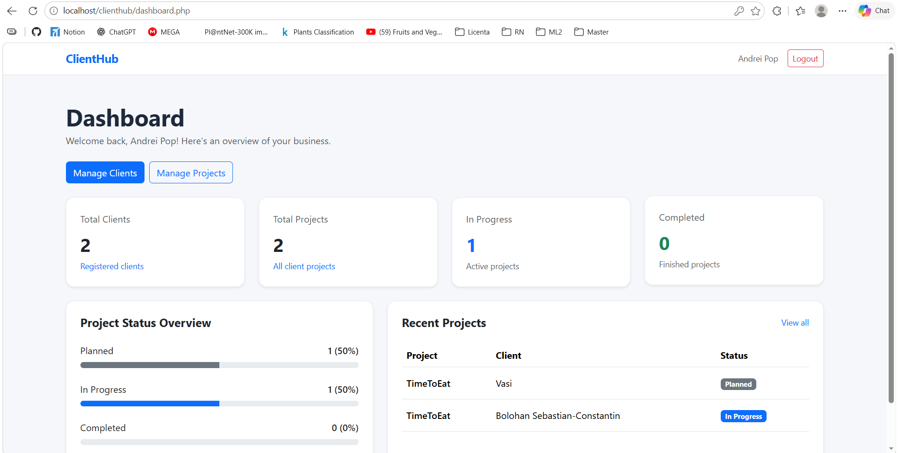
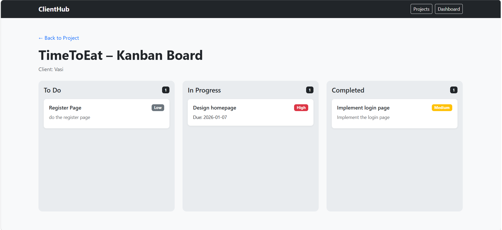
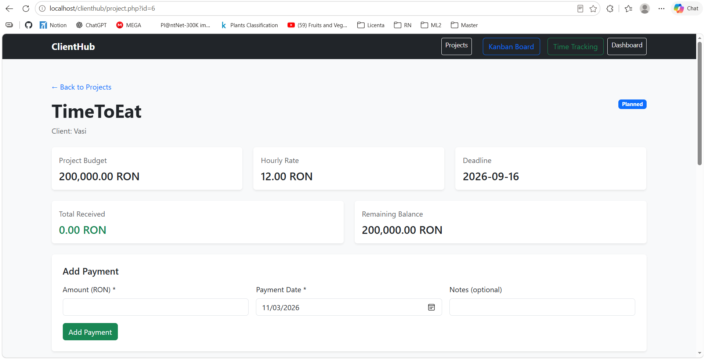
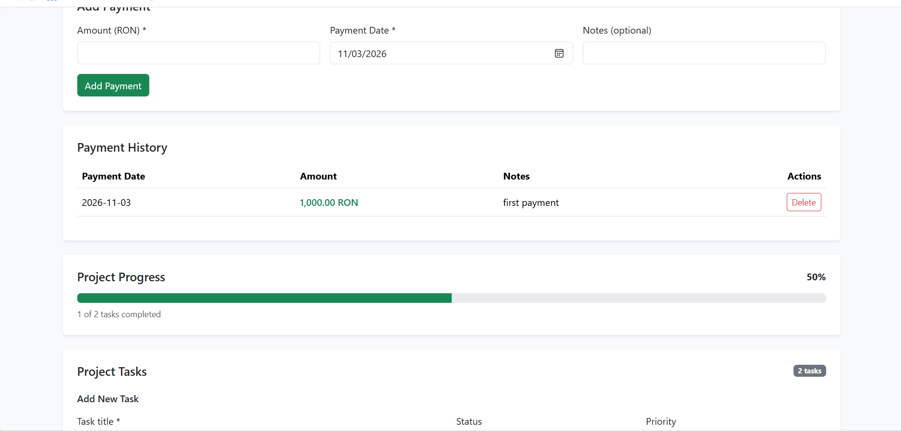
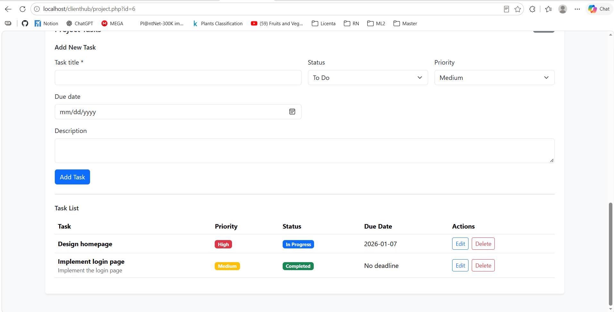
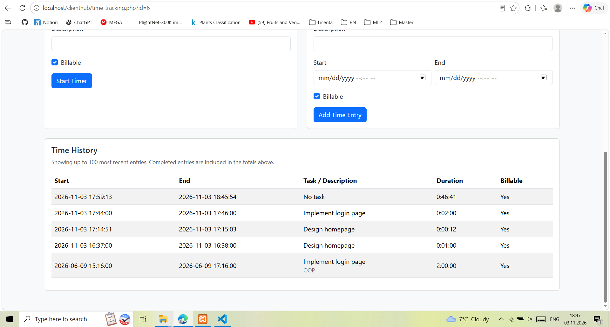
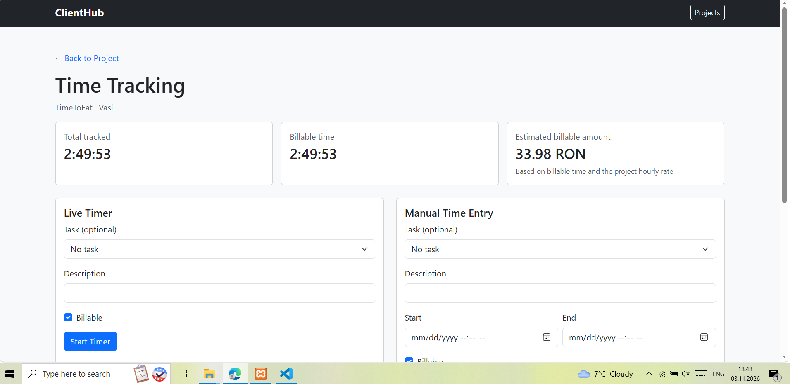
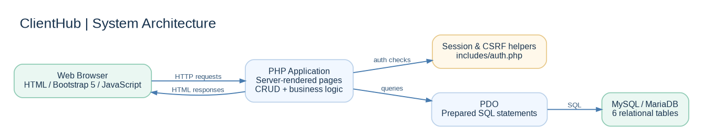
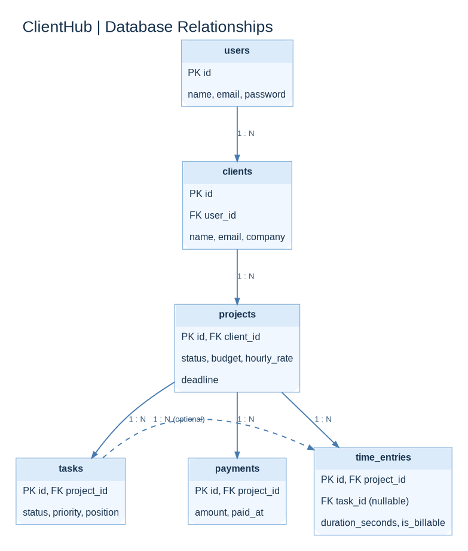
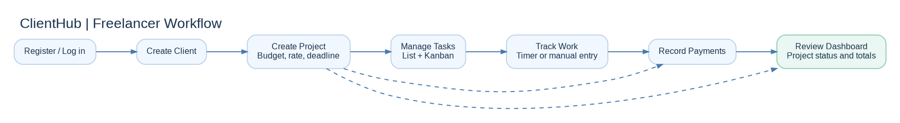

# ClientHub

**A lightweight CRM and project management application for freelancers.**

ClientHub brings client information, projects, tasks, time tracking, and payments into a single browser-based workspace. It helps freelancers organize their work, monitor project progress, record billable hours, and keep track of payments received against project budgets.

Built as a full-stack portfolio project using **PHP, MySQL/MariaDB, JavaScript, and Bootstrap 5**. The application runs locally with XAMPP; no public live demo is currently available.

## Features

- **User accounts:** registration, login, and logout with session-based authentication.
- **Client management:** maintain client contact information and notes.
- **Project management:** associate projects with clients and manage status, budgets, hourly rates, and deadlines.
- **Task management:** create and update tasks with priorities, due dates, and statuses.
- **Kanban board:** organize tasks using drag-and-drop status updates.
- **Time tracking:** use a live timer or manual entries, link time to tasks, and review billable time.
- **Payment tracking:** record payments, view payment history, and compare amounts received with project budgets.
- **Dashboard:** view client and project counts, status distribution, and recent projects.

Financial amounts are displayed in **RON (Romanian leu)**.

## Screenshots

### Dashboard

An overview of clients, projects, and project status.



### Kanban board

Task organization by status, with drag-and-drop interaction.



### Project details

Project budget, hourly rate, deadline, payment summary, and task management.







### Time tracking

Track billable time with a live timer or manual entries and review recorded sessions.





## System design

### Application architecture

ClientHub uses server-rendered PHP pages. The browser sends HTTP requests to the PHP application, which handles authentication, application logic, and database operations through PDO. MySQL/MariaDB stores application data.



### Database relationships

The relational database contains six tables: `users`, `clients`, `projects`, `tasks`, `time_entries`, and `payments`. Clients belong to users; projects belong to clients; tasks and payments belong to projects. Time entries belong to projects and can optionally reference a task.



### Typical workflow

A user creates an account, adds a client and project, manages tasks, tracks work, records payments, and reviews progress in the dashboard. The workflow diagram illustrates the main user journey, not a mandatory sequence enforced by the application.



## Tech stack

| Layer             | Technology                         |
| ----------------- | ---------------------------------- |
| Backend           | PHP 8.x                            |
| Database          | MySQL / MariaDB                    |
| Database access   | PDO with prepared statements       |
| Frontend          | HTML, CSS, JavaScript, Bootstrap 5 |
| Local environment | Apache and MySQL/MariaDB via XAMPP |
| Version control   | Git and GitHub                     |

The application uses server-rendered PHP pages and does not require a frontend build step.

## Getting started

### Requirements

- PHP 8.x with the `pdo_mysql` extension enabled
- MySQL or compatible MariaDB server
- PHP-capable web server, such as Apache via XAMPP

### 1. Clone the repository

```bash
git clone https://github.com/sebibolohan/ClientHub.git
```

For XAMPP on Windows, clone or move the project into `C:\xampp\htdocs\clienthub`.

### 2. Create and import the database

Create an empty database named `clienthub`, then import the included `schema.sql` file. In phpMyAdmin, select the `clienthub` database, choose **Import**, and upload `schema.sql`.

Alternatively, using a MySQL/MariaDB command-line client:

```bash
mysql -u root -p clienthub < schema.sql
```

The schema defines the tables and relationships; it does not contain sample accounts or client records. It was exported using MariaDB tooling, so a compatible MariaDB environment is recommended for import.

### 3. Configure the database connection

The application reads these environment variables in `config/database.php`:

| Variable      | Default when unset |
| ------------- | ------------------ |
| `DB_HOST`     | `127.0.0.1`        |
| `DB_NAME`     | `clienthub`        |
| `DB_USER`     | `root`             |
| `DB_PASSWORD` | Empty string       |

If your database credentials differ, set the variables in the PHP/web-server environment. The application uses `getenv()` and **does not automatically load `.env` files**. Never commit real credentials.

### 4. Run locally

Start **Apache** and **MySQL** in the XAMPP Control Panel. Open:

`http://localhost/clienthub/register.php`

Register an account, log in, then create a client and project to start using the application.

## Project structure

```text
ClientHub/
├── config/
│   └── database.php       # PDO database connection
├── includes/
│   └── auth.php           # Session, login and CSRF helpers
├── docs/
│   ├── architecture/      # Architecture, ERD and workflow diagrams
│   └── screenshots/       # Application screenshots
├── register.php           # Account registration
├── login.php              # Sign in
├── logout.php             # Sign out
├── dashboard.php          # Overview and statistics
├── clients.php            # Client management
├── projects.php           # Project management
├── project.php            # Project details, tasks and payments
├── tasks.php              # Task operations
├── kanban.php             # Kanban interface
├── kanban-update.php      # Kanban status update handler
├── time-tracking.php      # Time tracking interface
├── time-entry.php         # Time entry handler
├── payments.php           # Payment operations
├── schema.sql             # Relational database schema
└── README.md              # Project documentation
```

## Security considerations

The implementation includes password hashing, prepared SQL statements, session-based authentication, CSRF protection helpers, and ownership checks for relevant resources. Session cookies are configured with `HttpOnly` and `SameSite=Lax`; the `Secure` flag is enabled when HTTPS is detected.

**This is a portfolio project, not a security-audited production service.** Before public deployment, review authentication rate limiting, HTTPS enforcement, authorization coverage, production error handling, credential management, and backups.

## Project status

ClientHub is a locally developed portfolio application. Its source code and database schema are available in this repository. A hosted demo and an automated test suite are not currently provided.

## Repository

[GitHub — sebibolohan/ClientHub](https://github.com/sebibolohan/ClientHub)
